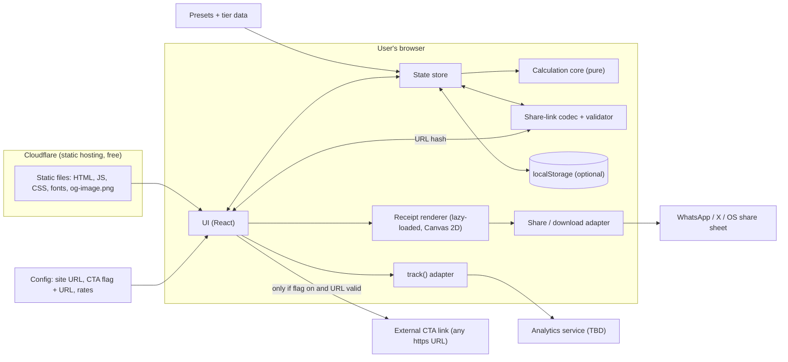

# ARCHITECTURE.md: Detty December 2026 Survival & Group Splitter

> Prompt 2 output. No application code. Inputs: REQUIREMENTS.md (with D1–D8, A1–A15, O1–O4).
> Constraints: $0, solo dev, 15–20 h, launch Tue Nov 24, 2026, static export on Cloudflare Pages.
> Items marked **VERIFY** were not confirmed from official docs. Check them before relying on them.

---

## 0. Headline decisions and one challenge

1. **There is no backend and no database.** Everything runs in the browser. The only "server" is Cloudflare serving static files. This makes Prompt 3 (SQL, RLS) mostly not applicable. See §9.
2. **Share-link state goes in the URL hash (`#...`), not the query string.** The hash is never sent to any server, so it stays private, can't break static hosting, and can't affect OG tags.
3. **Receipt export: draw directly on a Canvas 2D, not DOM screenshot.** A receipt is text lines, rules and a stamp, which is simple on canvas. This avoids the most likely failure (DOM-to-image libraries on iOS Safari and in-app browsers) and costs no bundle. This departs from your "html2canvas if needed" idea. The reasoning is in §3.
4. **Analytics:** Cloudflare Web Analytics does **not** support custom events (confirmed in its FAQ: "Not yet"), so your D7 can't be met with it alone. **Recommendation: use Umami Cloud's free Hobby plan as the single analytics script** (custom events, cookieless per its own FAQ). Caveats and the fallback are in §3.9.
5. **Challenge to your stack:** Next.js is heavier than this app needs. A single-page static calculator would also work in Vite + React or plain TypeScript. Next.js is still fine here, and the portfolio value of a familiar stack is real, but expect extra build/bundle weight. Keep client JS small by keeping the app to one route.
6. **Cloudflare note:** the Pages Next.js static-export guide still exists, but Cloudflare's own page says it recommends Workers (via vinext) for Next.js generally, and links a Pages→Workers migration guide. Both serve static files and both support a `_headers` file (verified, §3.8). Static assets on Workers are documented as free and unlimited. Check which one the dashboard offers on deploy day; the build output (`out/`) is the same either way.

---

## 1. Architecture overview

### Parts and responsibilities

| Part | Responsibility | Runs where |
|---|---|---|
| **Static shell** (Next.js page, built once) | HTML, CSS, fonts, JS bundle, static OG image and meta tags | Built locally or in CI, served by Cloudflare |
| **Config module** | Single source for site URL, CTA flag and URL, default rates, "as of" date, analytics ID | Build-time constants |
| **Presets data** | The 3 vibe presets (round-number estimates) and tier definitions (thresholds, badges, taglines) | Static TypeScript data |
| **Calculation core** | Pure functions: line totals, shared vs per-person split, group total, tier lookup, currency conversion | Browser, no framework dependency |
| **State store** | One state object (buckets, currency, rates, headcounts) with a reducer | Browser (React) |
| **Share-link codec** | Encode state to a compact hash string, decode and validate it back, fall back safely on bad input | Browser |
| **Persistence** | Optionally remember last calculation in `localStorage` (S3). Wrapped in try/catch, app works without it | Browser |
| **UI layer** | Preset picker, bucket editors, results, currency toggle, receipt preview, CTA card | Browser |
| **Receipt renderer** | Draws the receipt onto a canvas, outputs a PNG blob | Browser, loaded only on export |
| **Share/export adapter** | Web Share with file, else download, else on-screen image fallback | Browser |
| **Analytics adapter** | One small function `track(event)` that no-ops if no tool is configured | Browser plus third party (TBD, §3) |

### Diagram



---

## 2. Key data flows

### Flow A: First visit to a calculated receipt (the core path)

| Step | What happens | Where |
|---|---|---|
| 1 | Browser requests the page. Cloudflare returns static HTML and JS. | Cloudflare → browser |
| 2 | Page renders with the default scenario (preset "Soft Life Standard", 7 nights, group of 4, per A11). Results are visible immediately. | Browser |
| 3 | User taps a different preset, which replaces all bucket values. | Browser |
| 4 | User edits unit price, quantity, mode (shared/per-person) or headcount. The reducer updates state, the calculation core recomputes, results re-render. | Browser |
| 5 | User toggles currency. Only the display changes. Stored values stay in ₦ (M4). | Browser |
| 6 | The tier badge is derived from per-person ₦ total (A12) and shown live (S9). | Browser |
| 7 | **Before the tap:** when the receipt section nears the viewport, the renderer module is fetched; after about 500ms without edits, it loads the font, draws the canvas and caches the latest PNG blob. | Browser |
| 8 | User taps Export. The click handler uses the **already-built blob** (no awaiting of rendering before `share()`, because `share()` needs transient user activation and iOS has been reported to lose it after async work; see UI_PLAN.md §2.5). If the blob isn't ready yet: in a browser that can share files, show "Printing…" and ask for another tap; in one that can't, wait for the blob (up to 10 seconds) and finish on the first tap, because a download or the inline image needs no gesture. The share adapter uses Share only where the primary pointer is coarse (phones and tablets); on a desktop (mouse or trackpad) it starts at the download, because desktop share sheets are unreliable (T2.2 decision 6). Where Share is used it checks `navigator.canShare({ files })`. If true it opens the share sheet. Otherwise it triggers a download. If the anchor download is unsupported or throws, it shows the image inline with "press and hold to save" (a browser that silently refuses a download cannot be detected, so that case is not caught). | Browser, OS |
| 9 | `track("receipt_export")` is called (if an analytics tool is configured). | Browser → third party |

No network call is made in steps 2–8 after the first load.

### Flow B: Share link, sender to receiver

| Step | What happens | Where |
|---|---|---|
| 1 | Sender taps "Copy link". The codec serializes state to a short string in the URL hash, with a version prefix, in the positional hyphen-separated `#v1-…` format defined in DATA_MODEL.md §4. | Browser |
| 2 | Link is copied to the clipboard (with fallback: select-and-copy text field if the Clipboard API is blocked). | Browser |
| 3 | Sender pastes it into WhatsApp. WhatsApp fetches the **page without the hash** and reads the static OG tags, so every link previews the same site image (D4). | WhatsApp servers → Cloudflare |
| 4 | Receiver opens the link. The app reads the hash, validates every field (type, range, enum, length, version), clamps numbers and drops unknown fields. | Browser |
| 5 | If valid, state is restored as an **editable copy** (A3). If invalid or missing, it loads the default scenario and shows a small "couldn't read that link" notice. | Browser |

Why the hash: it is never sent to Cloudflare or any server, so logs can't see a group's numbers, and static hosting needs no rewrite rules.

Size check: 5 buckets × (price, quantity, mode, headcount) + currency + two rates is roughly 150–300 characters as compact text. That is short enough that **compression is not needed**, which saves a dependency. **VERIFY** with the worst-case test in Risk 3.

### Flow C: CTA (optional)

| Step | What happens |
|---|---|
| 1 | At build time, the flag and `NEXT_PUBLIC_CTA_URL` are inlined into the bundle. |
| 2 | At render time, the card shows only if the flag is on **and** the URL parses as `https:`. Otherwise nothing renders. |
| 3 | On click, `track("cta_click")` fires (if configured) and the link opens in a new tab with `rel="noopener noreferrer sponsored"` when it is an affiliate or paid link. |

Changing the CTA means changing the variable in Cloudflare and redeploying (O4).

---

## 3. Tech decisions

Format: **recommendation**, alternatives, why, what would change my mind.

### 3.1 Framework and rendering
- **Recommend:** Next.js App Router with `output: 'export'`, a single route, one client component tree for the calculator, TypeScript strict.
- **Alternatives:** Vite + React SPA; plain TS with no framework.
- **Why:** You already know Next.js, static export is supported on Cloudflare, `next/font` self-hosts fonts at build time (fast, no third-party request), and it reads well on a portfolio. A Vite SPA would ship less framework code but you would give up familiarity.
- **Change my mind if:** the first-load JS budget (§5 of REQUIREMENTS: ~150 KB gzipped, a guess) can't be met, or a static-export limitation blocks something.
- **Static export caveats:** no API routes, no server actions, no middleware, no image optimization (set images to unoptimized), no dynamic routes without pre-generation. None are needed here.

### 3.2 State management
- **Recommend:** React `useReducer` plus a context provider, with all math in pure functions outside React.
- **Alternatives:** Zustand; Redux Toolkit.
- **Why:** One screen and one small state object. Pure functions are trivially unit-testable and reusable by the receipt renderer. No extra dependency.
- **Change my mind if:** state starts being shared across many distant components with performance problems (unlikely).

### 3.3 Money and numbers
- **Recommend:** Store all amounts as whole-number naira. Store exchange rates as "₦ per 1 unit of foreign currency." Convert only for display. Round each line at display precision and make the displayed total the sum of the displayed lines, so the receipt always adds up. The tier uses the exact ₦ total (rules in DATA_MODEL.md §2.4).
- **Alternatives:** Floating-point amounts per currency; kobo integers.
- **Why:** One canonical currency avoids compounding rounding when toggling (M4), and naira has no practical need for kobo in estimates.
- **Change my mind if:** you add per-currency price entry (out of MVP).

### 3.4 Share-link state strategy
- **Recommend:** URL hash, versioned (`v1`), compact human-inspectable text (delimited fields), strict validation, safe fallback. No compression.
- **Alternatives:** Query string; base64 JSON; LZ-compressed JSON (adds a dependency).
- **Why:** Hash keeps data off servers and off OG fetches; compact text is short and debuggable. A version prefix lets you change the format later without breaking old links.
- **Change my mind if:** the worst-case link is long enough to break in WhatsApp (Risk 3). Then add compression or shorten keys.

### 3.5 Receipt export (the highest-risk decision)
- **Recommend:** **Canvas 2D drawn directly** from the state, no DOM capture. Lazy-load the module on first export. Preload the chosen font with the browser's font-loading API before drawing, or text will render in a fallback font.
- **Alternatives:**
  1. `html-to-image` (about 25 KB minified per one comparison article): easiest if the receipt is designed as HTML/CSS and the browser does the styling, so Grid, custom properties and filters work. It rasterizes through SVG `foreignObject`, which that article rates "Variable" on Safari. Web fonts must be preloaded (wait for `document.fonts.ready`). The article recommends it for TypeScript projects targeting modern browsers.
  2. `html2canvas` (about 200 KB minified per the same article): rated "Good" on Safari there, but it re-implements CSS itself, so Grid and some other features are only partly supported and web fonts need explicit configuration. Its issue tracker and Apple forum threads also contain iOS-specific failure reports (search results only, not reviewed in detail). It is the heaviest option for a 150 KB first-load budget, though it is lazy-loaded.
  *(The comparison comes from a single blog post. Treat the sizes and ratings as indicative and confirm with your own device spike. The post didn't cover iOS or in-app browsers specifically.)*
  3. Server-side rendering of the image: rejected, since there is no backend and it breaks the $0/static constraint.
- **Why Canvas:** the receipt is text, lines and a stamp, which is exactly what canvas does well, and it behaves the same across Safari, Chrome, and in-app browsers because it doesn't depend on CSS rasterization. Zero dependency. Cost: you hand-lay out the receipt (about 1–2 h more than HTML/CSS), and any later visual change means editing drawing code.
- **Day 1 spike plan:** draw a mock receipt on canvas, export on a real iPhone, a mid-range Android, and inside WhatsApp, Instagram and TikTok in-app browsers. If you'd rather prototype fast, run `html-to-image` against the same devices in parallel and keep whichever works.
- **Change my mind if:** you want a design that is awkward on canvas (complex gradients, many fonts, rich text wrapping), or the canvas spike fails in in-app browsers. In that case the fallback is the inline-image "press and hold to save" path.

### 3.6 Share / download behavior
- **Recommend:** Feature-detect `navigator.canShare({ files })`, call share from the click handler (a user gesture is required), over HTTPS, as the primary path. Fall back to a download link, then to showing the image inline.
- **Verified (web.dev):** file sharing needs `canShare` first, HTTPS and a user gesture, and only supports some file types (images are supported). Its support table lists Chrome 128, Edge 93, Safari 12.1 (`canShare` from Safari 14), Firefox behind a flag. The recommended fallback is exactly the chain above: if `canShare` fails, download via a hidden anchor with the `download` attribute (Safari 10.1+), and ignore `AbortError` when the user cancels.
- **Not verifiable from docs:** how Instagram, TikTok, WhatsApp and X in-app browsers behave. My searches returned no authoritative source, only forum threads about blocked downloads in embedded browsers. This can only be settled by the Day 1 device test, so the inline "press and hold to save" fallback stays in the design.
- **Change my mind if:** in-app browsers block both share and download in testing. Then add an "Open in browser" hint when the user agent looks like an in-app browser. T9.2 added the hint only, behind a best-effort user-agent check; the chain is unchanged.

### 3.7 Styling and UI libraries
- **Recommend:** Tailwind v4 (CSS-first: `@import "tailwindcss"` and `@theme inline` in `app/globals.css`, no config file), a small token set in CSS variables, a handful of hand-written components, no component library. Two fonts via `next/font` (Bungee for words, Space Mono for body and all numbers; both with `latin` and `latin-ext` subsets so the ₦ sign renders), exposed as `--font-bungee` and `--font-space-mono`. Icons: Phosphor (`@phosphor-icons/react`) with `experimental.optimizePackageImports`. System theme only (no in-app toggle). Full token list, icon map and rules are in DESIGN.md.
- **Alternatives:** shadcn/ui; Radix primitives.
- **Why:** Few components, a distinct receipt-first look, and a smaller bundle. Hand-write the one thing that needs accessibility care (segmented currency toggle, shared/per-person switch) as native inputs.
- **Change my mind if:** you need a complex control (dialog, popover) that is costly to make accessible by hand.

### 3.8 Hosting
- **Recommend:** Cloudflare Pages (or Workers static assets, see §0.6), free `.pages.dev` subdomain, build command `yarn build`, output directory `out` (from Cloudflare's static Next.js guide), connected to a GitHub repo for auto-deploy.
- **Alternatives:** Vercel Hobby; GitHub Pages; Netlify.
- **Why:** Free, global CDN, and the limits are not a concern for a small static site. Verified: Pages free limits are 500 builds/month, 20,000 files, 25 MiB per file, and Workers static assets are documented as free and unlimited.
- **Commercial-use check (partly verified):** In Cloudflare's general terms and Self-Serve Subscription Agreement I found **no ban on commercial use of free plans**. Free Services are offered without liability and Cloudflare may end them at its sole discretion (§2.6), and you may not collect card details on a property receiving free services (§2.2.1(h)). Linking out to a Paystack page doesn't do that. I could **not** read the Developer Platform / service-specific terms, so that part is unconfirmed. For Vercel, I could not find the "non-commercial" wording on the Hobby and fair-use pages I fetched (parts rendered blank, and the terms page was blocked), so I can't confirm that claim from official text either. I've softened it in REQUIREMENTS.md.
- **Change my mind if:** a Cloudflare build or deploy problem costs more than an hour on launch weekend. Then switch to the next-easiest static host rather than debug.

### 3.9 Analytics (resolves O3)
- **Verified:** Cloudflare Web Analytics FAQ says custom events are "Not yet" supported. It records pageviews and performance only. It keeps unsampled data for 7 days, then aggregates, and retains six months of aggregated data. The FAQ I read did not state its cookie or consent behavior, so **VERIFY** that before claiming "no banner."
- **Option 1 (recommended):** Umami Cloud, using custom events for `receipt_export`, `link_copy`, `cta_click`. From its pricing page and FAQ: the free Hobby plan has **100K events per month, 1 website and 6 months retention**. Each pageview or custom event counts as one event. Umami states it "does not use cookies or collect any personally identifiable information" and that no cookie consent banner is needed. Budget check: if a session averages about 4 events (1 pageview plus a few custom events), 100K covers roughly 25,000 sessions a month. **What happens past the cap is not documented** on the Umami FAQ, Usage or Subscription pages I read. The Subscription page only covers paid plans, where tracking pauses when a spending budget is hit ("Umami stops recording events until the next billing period"). Assume the worst case for Hobby: tracking stops or data is dropped, and **the app must not depend on it**. `track()` is fire-and-forget (§5), so the calculator keeps working either way. If you want certainty, ask Umami support.
- **Option 2:** Cloudflare Web Analytics for pageviews only, and no export or link-copy measurement. Measure CTA clicks through the destination's own dashboard plus UTM tags. Cheapest, but you lose the main portfolio metrics.
- **Option 3:** No analytics at launch. Fastest, but you can't tell whether it worked.
- **Rule:** use **one** analytics script, not two. Each extra script costs performance on weak phones.
- **Decision:** go with Option 1 (Umami Cloud). Keep `track()` behind the adapter so swapping tools is a one-file change. If the cap or behavior at the cap is a problem, fall back to Option 2. Because only one script is used, Cloudflare Web Analytics is not added, so its cookie behavior (not confirmed; the page I tried to read was blocked) no longer matters.

### 3.10 Testing approach (for later prompts)
- Unit tests (Vitest) for the calculation core, number-input parsing, the share-link codec including malformed input, and tier lookup.
- Component tests (Vitest, jsdom, Testing Library) for stateful UI such as `NumberField`, queried by role and label; no snapshots.
- One end-to-end happy path (Playwright), plus manual device checks for the receipt (these can't be automated reliably).

---

## 4. Third-party services and cost

| Service | Free-tier facts I verified | What happens at the limit | Privacy/surprise notes |
|---|---|---|---|
| **Cloudflare Pages / Workers static assets** | Pages: 500 builds/month, 1 concurrent build, 20,000 files per site, 25 MiB max per file, 100 custom domains per project, no stated bandwidth cap. Workers: static asset requests documented as free and unlimited. | Builds queue or fail past 500/month. Not a risk for you. | Requests to Pages **Functions** count toward the Workers plan. You use none, so don't add any. On Workers, avoid `run_worker_first` on the free plan (over-limit requests get a 429). No commercial-use ban found in the general terms; Developer Platform terms not read. |
| **Cloudflare Web Analytics (not used)** | No custom events. 7-day unsampled retention, then aggregated, with about 6 months retained. | n/a | Cookie/consent behavior not confirmed. Not needed if Umami is the single script. |
| **Umami Cloud (chosen)** | Hobby plan: 100K events/month, 1 website, 6-month retention. Custom events supported. Cookieless and no consent banner needed, per Umami's own FAQ. | Hobby behavior past the cap is **not documented** (paid plans pause tracking at a budget). Treat as "tracking may stop." | Vendor's own privacy claim, not independently verified. |
| **Google Fonts via `next/font`** | Fonts are downloaded at build time and self-hosted. | n/a | No runtime request to Google, which is better for privacy and speed. |
| **GitHub** | Repo and CI | n/a | Use a public repo for the portfolio; never commit `.env` secrets (none exist). |
| **Custom domain (optional)** | Paid, outside $0 budget | n/a | O2 in REQUIREMENTS. |

No paid API and no secret keys exist anywhere in this design. `NEXT_PUBLIC_*` variables are public by design.

---

## 5. Failure modes

| What can go wrong | Design response |
|---|---|
| Share link is corrupted, truncated by WhatsApp, or tampered with | Strict validation per field, ignore unknowns, clamp numbers to sane ranges, fall back to the default scenario, show a non-blocking notice |
| Link from an older format | Version prefix. Unknown versions fall back to the default scenario |
| Absurd inputs (negative, huge, NaN, headcount 0) | Clamp and validate at the state boundary; headcount minimum 1 (M3); cap displayed totals so layout can't break |
| Canvas export blank or wrong font | Wait for the font to load before drawing; log a visible error state with retry |
| Share sheet unavailable or cancelled | Cancel is not an error. Unavailable falls through to download, then to inline image |
| In-app browser blocks download and share | Inline image with "press and hold to save" instructions, plus an "open in browser" hint |
| `localStorage` blocked or full (private mode, in-app) | Wrap in try/catch, app works without persistence |
| Clipboard API blocked | Fallback to selectable text field and manual copy |
| Analytics blocked by an ad-blocker or tool down | `track()` is fire-and-forget and never throws or blocks the UI |
| CTA URL missing or invalid | Card is not rendered. No empty space, no broken link |
| Bad deploy | Cloudflare keeps previous deployments; roll back from the dashboard |
| Slow or offline network after first load | Everything runs locally after the page loads, so only first load depends on the network |
| Abuse | There is nothing to abuse server-side: no writes, no accounts, no APIs |
| Stale exchange rates | "As of" date visible in the UI and on the receipt (S7), and rates are editable |

---

## 6. Security boundaries

- **Trust boundary:** the only untrusted input is the URL hash (plus any user-typed numbers). There is no server to enforce anything, so **all validation lives in the client**. This is acceptable only because nothing sensitive or shared exists. A malicious link can at worst show the receiver a silly calculation.
- **Never render link content as HTML.** All values are parsed into numbers/enums and displayed through React text nodes or drawn on a canvas, never injected as markup.
- **No free-text fields in MVP**, which removes the main XSS and content-abuse vector (and any "offensive receipt" screenshots with your URL on them).
- **Secrets:** none exist. `NEXT_PUBLIC_CTA_URL` is public by design and must never contain a secret or tokenized URL.
- **Outbound links:** `noopener noreferrer`, plus `sponsored` for affiliate or paid links.
- **Headers (verified in Cloudflare docs):** put a plain-text `_headers` file (no extension) in `public/` so it is copied into the build output. Format: a URL pattern line, then indented `Name: value` lines. Limits: 100 rules, 2,000 characters per line. It applies to static asset responses, which is all you serve. Use it for a Content-Security-Policy, referrer policy and `frame-ancestors`. A strict CSP can conflict with the Umami script and with Next.js inline scripts, so add it last, test it, and loosen it if the page or analytics breaks.
- **Dependencies:** minimal and pinned; run the package manager's audit once before launch.

---

## 7. Project structure

```
detty-splitter/
├─ app/                    # default create-next-app layout, nothing moved
│  ├─ favicon.ico
│  ├─ globals.css          # Tailwind layers + design tokens
│  ├─ layout.tsx           # fonts, metadata, OG tags, analytics script
│  └─ page.tsx             # the single page, composes components
├─ components/             # presentational UI: PresetPicker, BucketEditor,
│                          # ResultsPanel, DamageMeter, CurrencyToggle, Receipt (HTML), TierStamp,
│                          # CtaCard, ShareBar, LinkNotice
├─ lib/
│  ├─ calc/                # pure math: line totals, split, tier lookup
│  ├─ money/               # currency conversion and formatting
│  ├─ input/               # number-input parsing, clamping, draft and caret helpers
│  ├─ share/               # hash encode, decode, validate; load.ts (hash > snapshot > default);
│  │                       # link.ts (build the link, copy to clipboard)
│  ├─ receipt/             # view.ts: ReceiptView builder + fixed copy (static, T7.1);
│  │                       # layout.ts (pure draw ops) + render.ts (canvas shell, lazy-loaded, T7.2)
│  ├─ export/              # share / download / inline-image fallback chain (index.ts, T9.1);
│  │                       # browser.ts: the navigator and anchor-download wrappers
│  ├─ storage/             # safe localStorage wrapper (readSnapshot, writeSnapshot)
│  └─ analytics/           # track() adapter
├─ state/                  # reducer, actions, session (app state + load info), local save, context provider
├─ data/                   # presets, tiers and taglines, bucket definitions
├─ config/                 # site URL, CTA flag and URL, default rates + as-of date
├─ public/                 # og-image.png, _headers
├─ tests/                  # unit tests for calc, share, receipt helpers; one e2e
├─ next.config.ts          # output: 'export', unoptimized images
├─ tsconfig.json           # path alias "@/*" -> "./*"
├─ .env.example            # NEXT_PUBLIC_CTA_URL, NEXT_PUBLIC_CTA_ENABLED
└─ ARCHITECTURE.md, REQUIREMENTS.md, DATA_MODEL.md, (later) DESIGN.md, BUILD_PLAN.md
```

No `src/` folder. `app/` is the stock `create-next-app` folder (`favicon.ico`, `globals.css`, `layout.tsx`, `page.tsx`), and the other folders are siblings of it at the project root. Per the Next.js docs, `components/` and `lib/` have no special meaning and live outside `app/` here, which the docs list as a valid strategy ("store project files outside of `app`"). When you run `create-next-app`, answer **No** to "Use `src/` directory?". Make sure Tailwind picks up classes in `components/` too (Tailwind v4 detects sources automatically; on v3 list the folders in the config).

Rules of placement:
- `lib/calc`, `lib/money`, `lib/input`, `lib/rates`, `lib/author`, `lib/share`, `lib/storage` must not import React. This keeps them testable and reusable by the receipt renderer.
- Components never contain pricing numbers; those live in `data/`.
- Every environment variable is read in `config/` only.
- Tier thresholds and taglines live in `data/` so you can tune them (O1) without touching logic.

---

## 8. Decisions I can postpone

- Dynamic OG images (C1), extra receipt formats (C2), live exchange rates (C4), more presets or cities (C7).
- In-app theme toggle (DESIGN.md follows the system theme; a toggle is a COULD).
- Full CSP lockdown (do last).
- Compression of share links (only if Risk 3's test fails).
- PWA/offline (C9).
- Custom domain (O2) and its purchase.
- Final tier thresholds (O1) until price research is done.
- Settle-up, named participants (C3).

---

## 9. Open verification list (do before or during build)

Checked from official docs this session: Cloudflare Pages limits, Workers static-asset billing, `_headers` syntax and limits, Cloudflare Web Analytics having no custom events, Umami Hobby limits and cookieless claim, Web Share API requirements and fallback pattern. **Still open (cannot be settled from docs):**

1. **Real-device tests (Day 1 spike):** receipt export, Web Share and download on a real iPhone, a mid-range Android, and the WhatsApp, Instagram, TikTok and X in-app browsers. No authoritative documentation exists for the in-app browsers.
2. **Worst-case share-link length** in WhatsApp (Risk 3). Needs a real paste test.
3. **CSP vs the Umami script and Next.js inline scripts.** Needs a test build.
4. **Umami Hobby behavior past 100K events.** Undocumented. Optional: email Umami support. The design tolerates either outcome.
5. **Cloudflare Developer Platform / service-specific terms** (the part I couldn't read), if you want certainty on commercial use. The general terms show no ban.
6. **DOM-capture libraries on iOS:** only matters if you reject Canvas 2D. My only comparison source is one blog post.

---

## 10. Note for Prompt 3 (Data model and security)

This project has no database, accounts, or access policies, so the SQL and RLS sections of Prompt 3 don't apply. I suggest running Prompt 3 as a short **state schema and share-link format spec**:
- the TypeScript state shape and its valid ranges;
- the exact `v1` hash format and validation rules;
- the preset and tier data schema;
- a list of malformed-link test cases.

That spec becomes `DATA_MODEL.md` and keeps the same slot in your playbook.

---

## Sources

- [Cloudflare Web Analytics FAQ](https://developers.cloudflare.com/web-analytics/faq/index.md)
- [Cloudflare Pages limits](https://developers.cloudflare.com/pages/platform/limits)
- [Cloudflare: Deploy a static Next.js site](https://developers.cloudflare.com/pages/framework-guides/nextjs/deploy-a-static-nextjs-site/)
- [web.dev: Web Share API](https://web.dev/articles/web-share)
- [Umami Cloud FAQ](https://docs.umami.is/docs/cloud/faq)
- [Umami pricing](https://umami.is/pricing)
- [html2canvas vs dom-to-image vs html-to-image comparison](https://dev.to/shaishav_patel_271fdcd61a/html2canvas-vs-dom-to-image-vs-html-to-image-browser-screenshot-library-comparison-4h5c) (single blog post)
- [Apple Developer Forums: html2canvas on iOS 15](https://developer.apple.com/forums/thread/690805) (search result only, not fully reviewed)