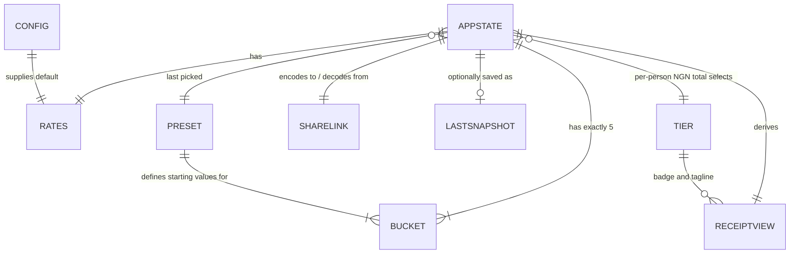

# DATA_MODEL.md: Detty December 2026 Survival & Group Splitter

> Prompt 3 output, adapted. This project has **no database, no accounts and no access policies**, so there is no SQL, RLS or migrations. The "data layer" is: the in-browser state schema, the share-link format, the static data files, and the validation rules that make an untrusted URL safe.
> Inputs: REQUIREMENTS.md, ARCHITECTURE.md. Type blocks below are schema definitions, not application code.

---

## 0. Decisions made here that change other docs

| # | Decision | Why | Doc to update |
|---|---|---|---|
| 1 | **Add a global `groupSize`** (the number of people on the trip) beside each shared bucket's own headcount. | REQUIREMENTS D2 gave only per-bucket headcounts, but "group total", the "apply group size to all" shortcut and per-person buckets all need to know how many people there are. | REQUIREMENTS M3, S1 |
| 2 | **Group total = per-person total × `groupSize`.** | The only definition that is never ambiguous when a shared headcount differs from the group size. It equals the real money spent when every shared headcount equals `groupSize`. Label it "group total" and keep the per-person figure as the headline. | REQUIREMENTS M3 |
| 3 | **Rounding rule:** round each line at display precision, and the displayed grand total is the **sum of the displayed lines**, so the receipt always adds up. The tier uses the exact (unrounded) ₦ total. | A receipt that doesn't add up looks broken and gets screenshotted for the wrong reason. | ARCHITECTURE §3.3 |
| 4 | **Share link format v1** is a positional, hyphen-separated hash (§4). Not JSON, not compressed. | Short (about 130 characters max), safe in WhatsApp, trivial to validate strictly. | ARCHITECTURE §3.4 |
| 5 | **No default exchange rates are invented here.** Defaults live in `config/` with an "as of" date you set from a real source before launch. | Any rate I wrote would be a guess and would go stale. | REQUIREMENTS A1 |

---

## 1. Entities

| Entity | What it is | Where it lives |
|---|---|---|
| **AppState** | The whole calculation: preset, currency, rates, group size, 5 buckets | In memory (React reducer) |
| **Bucket** | One of 5 fixed cost lines: unit price × quantity, shared or per-person, headcount | Inside AppState |
| **Rates** | ₦ per $1 and ₦ per £1 (editable) | Inside AppState; defaults in Config |
| **Preset** | A named starting point that fills AppState | Static data file |
| **Tier** | A spend band with badge and tagline, chosen from the per-person ₦ total | Static data file |
| **ShareLink** | A string encoding of AppState in the URL hash | Browser URL, clipboard |
| **LastSnapshot** | The same string stored locally so a returning user resumes (S3) | `localStorage` |
| **ReceiptView** | A derived, display-ready object for the receipt renderer | Computed, never stored |
| **Config** | Site URL, CTA flag and URL, default rates and date, analytics ID | Build-time constants |
| **AnalyticsEvent** | A named event with tiny, non-identifying properties | Sent to the analytics tool |



---

## 2. State schema

### 2.1 Shape

```ts
type BucketId = 'stay' | 'events' | 'tables' | 'transport' | 'food'   // fixed order
type Mode = 'shared' | 'perPerson'
type CurrencyCode = 'NGN' | 'USD' | 'GBP'
type PresetId = 'budget' | 'soft' | 'baller'

interface Bucket {
  id: BucketId
  unitPriceNgn: number   // whole naira, price of ONE unit
  quantity: number       // number of units (nights, events, table nights, days)
  mode: Mode
  headcount: number      // people sharing this item; ignored when mode = 'perPerson'
}

interface AppState {
  presetId: PresetId     // last preset picked (used by "Reset to preset")
  currency: CurrencyCode // display only
  groupSize: number      // people on the trip
  rates: { ngnPerUsd: number; ngnPerGbp: number }
  buckets: [Bucket, Bucket, Bucket, Bucket, Bucket]  // order = BucketId order above
}
```

### 2.2 Valid ranges (enforced in the reducer, and again when decoding a link)

| Field | Type | Range | Notes |
|---|---|---|---|
| `unitPriceNgn` | integer | 0 to 50,000,000 | Clamp. ₦ only; entered in ₦, shown in the chosen currency |
| `quantity` | integer | 0 to 999 | Clamp. 0 is allowed (bucket contributes ₦0) |
| `mode` | enum | `shared` / `perPerson` | Anything else is rejected |
| `headcount` | integer | 1 to 100 | Clamp up to 1, never 0 (prevents divide-by-zero) |
| `groupSize` | integer | 1 to 100 | Clamp |
| `currency` | enum | `NGN` / `USD` / `GBP` | Display only: `setCurrency` writes nothing else, so ₦ values, rates and the tier never move. An unknown code is rejected (ignored by the reducer, rejected by the decoder) |
| `rates.ngnPerUsd`, `ngnPerGbp` | number, at most 2 decimals | 50 to 100,000 | The rate field rejects an out-of-range number: it shows a hint and keeps the old rate (T5.2; clamping a typo like 15 into 50 would look plausible). The reducer (`setRate`) and the link decoder clamp. Never 0 or negative (prevents divide-by-zero) |
| `presetId` | enum | `budget` / `soft` / `baller` | |

Input-field rules: users may type commas or spaces; strip them, then parse. Empty or non-numeric input keeps the previous value rather than writing `NaN`. Rates also take one `.` and at most 2 decimals (more is rejected, never rounded); commas are always thousands separators, never decimals.

### 2.3 Bucket semantics

| Bucket | Unit label | Default mode |
|---|---|---|
| `stay` Short-lets / accommodation | per night | shared |
| `events` Concerts & raves | per event | per person |
| `tables` Club tables | per table night | shared |
| `transport` Transport / SUV / security | per day | shared |
| `food` Daily food & drinks | per day | per person |

Meaning of **mode**:
- **shared:** `lineTotal = unitPrice × quantity` is one bill split across `headcount` people. Your share = `lineTotal / headcount`.
- **perPerson:** `unitPrice × quantity` is what **each person** pays. Your share = `unitPrice × quantity`. `headcount` is stored but unused.

**Group size and headcounts (S1).** Changing `groupSize` changes only the group total; it never touches a headcount. "Apply to all shared" sets `headcount = groupSize` on every `shared` bucket and leaves `perPerson` buckets alone, so their stored split comes back if you switch them to shared. If every shared headcount already equals `groupSize`, or no bucket is shared, it changes nothing.

### 2.4 Derived values (never stored)

```
lineTotal(b)      = unitPriceNgn × quantity
yourShareNgn(b)   = mode = shared ? lineTotal / headcount : lineTotal
perPersonNgn      = Σ yourShareNgn(b)          // exact, unrounded; drives the tier
groupTotalNgn     = perPersonNgn × groupSize
displayAmount(x)  = x / rate(currency)         // rate(NGN) = 1
```

**Rounding (decision 3):**
1. Convert each line's `yourShareNgn` to the display currency.
2. Round each line: NGN to the nearest whole ₦ (round **up** so shares never undercount a shared bill), USD/GBP to the nearest cent.
3. Displayed per-person total = sum of the displayed (rounded) lines.
4. Displayed group total = displayed per-person total × `groupSize`.
5. Tier is chosen from the **exact** `perPersonNgn`, so changing currency can never change the tier (A12).

### 2.5 Worked example (golden test)

Illustrative numbers only: not real Lagos prices, and the rate is not a real rate. Group size 4, every shared headcount 4, rate ₦1,500 per $1. Before R1 these were also the Soft Life preset; after R1 they are not, and the unit tests keep them as fixed fixture values (`tests/setup.ts`).

| Bucket | Price × qty | Mode | Line total | Your share (₦) |
|---|---|---|---|---|
| Stay | ₦150,000 × 7 | shared ÷ 4 | 1,050,000 | 262,500 |
| Events | ₦100,000 × 3 | per person | 300,000 | 300,000 |
| Tables | ₦800,000 × 2 | shared ÷ 4 | 1,600,000 | 400,000 |
| Transport | ₦60,000 × 7 | shared ÷ 4 | 420,000 | 105,000 |
| Food | ₦40,000 × 7 | per person | 280,000 | 280,000 |

- Per person: ₦1,347,500. Group total: ₦5,390,000 (equals 1,050,000 + 1,200,000 + 1,600,000 + 420,000 + 1,120,000, i.e. real money, since all headcounts equal the group size).
- Tier (thresholds in §3.2): ₦1.2M to 2.5M after R1, so **Tier 3**.
- In USD: lines are 175.00, 200.00, 266.67, 70.00, 186.67, so the displayed per-person total is **$898.34** (the exact value is $898.33; the one-cent gap is the documented rounding rule). Group total shown: $898.34 × 4 = **$3,593.36**.
- Switching to NGN or GBP must not change the tier.

---

## 3. Static data files (`data/`)

### 3.1 Presets

```ts
interface Preset {
  id: PresetId
  label: string        // 'Outside on a Budget' | 'Soft Life Standard' | 'Full IJGB / Baller Mode'
  blurb: string        // one line of vibe copy
  groupSize: number
  buckets: Omit<Bucket, 'id'>[]   // exactly 5, in BucketId order
}
```

Rules:
- Exactly 3 presets, all with 5 buckets in the fixed order.
- All prices are whole naira, rounded to a "round number" feel (D1).
- **Values are R1 estimates (28 Nov 2026) from public Lagos prices.** Do not present them as quotes. Show the "estimates, tap any number to edit" label everywhere.
- Default scenario on first load: `soft`, group size 4, 7 units where it applies (A11).
- "Reset to preset" restores the last-picked preset's values into AppState, including `groupSize`, but keeps the user's `currency` and `rates`.

### 3.2 Tiers

```ts
interface Tier {
  id: 1 | 2 | 3 | 4 | 5
  minPerPersonNgn: number   // inclusive lower bound
  badge: string
  tagline: string
  balanceLine: string       // the "AVAIL BAL" joke line on the receipt
}
```

Rules:
- Thresholds strictly ascending; tier 1 `minPerPersonNgn = 0`.
- Selection: the highest tier whose `minPerPersonNgn <= perPersonNgn` (exact value).
- Bounds tuned in R1: 0, 600,000, 1,200,000, 2,500,000, 4,000,000, so Budget, Soft Life and Baller land in Tiers 1, 3 and 5.
- Badge and tagline copy lives only in this file.

### 3.3 Config (`config/`, the only place env vars are read)

| Key | Source | Rules |
|---|---|---|
| `SITE_URL` | constant | Used for the receipt watermark and metadata. One-line swap for a custom domain |
| `SITE_NAME`, `SITE_TITLE`, `SITE_DESCRIPTION` | constants | Page title, description and Open Graph site name (T10.2). Draft copy in the app's voice (DESIGN §9). The description stays at or under 160 characters (`tests/metadata.test.ts`) |
| `OG_IMAGE_PATH`, `OG_IMAGE_SIZE`, `OG_IMAGE_ALT` | constants | The one static link-preview image, `public/og-image.png`, 1200 × 630 (DESIGN §7.3). The test reads the real file and compares its size with `OG_IMAGE_SIZE`. The alt text quotes the sample receipt's total, so update it if the sample changes |
| `OG_LOCALE` | constant | `og:locale`, format `ll_CC`. `en_GB`, because Facebook has no `en_NG` (its English locales are `en_GB` and `en_US`) |
| `X_HANDLE` | constant | The author's X handle (`@joshardals`), used as `twitter:site`. Public by design |
| `THEME_COLOR` | constant | Mobile toolbar colour (`theme-color`). Must equal `--danfo` in `globals.css`; `tests/metadata.test.ts` compares them |
| `CTA_ENABLED` | `NEXT_PUBLIC_CTA_ENABLED` | On only if the value is exactly the string `true`. Anything else is off |
| `CTA_URL` | `NEXT_PUBLIC_CTA_URL` | Must parse as a URL with protocol `https:` (`parseHttpsUrl`, shared from `lib/author`). Otherwise treated as unset |
| `CTA_TITLE`, `CTA_BUTTON_TEXT`, `CTA_DISCLOSURE` | constants | Placeholder wording until C1. A non-empty `CTA_DISCLOSURE` (the link is an affiliate or paid promo) shows the disclosure line under the button and adds `sponsored` to the link's `rel`. Empty means neither |
| `DEFAULT_RATES` + `RATES_AS_OF` | constants | You set these from a real source before launch; date shown in the UI and receipt |
| `ANALYTICS_SITE_ID` | constant | Public by design (Umami site IDs are embedded in page source). Empty by default: no script is added and `track()` does nothing. Paste the website ID (a UUID) from the Umami dashboard before launch. `umamiScriptProps` (`lib/analytics`) treats anything that is not a UUID as unset (T10.3) |
| `ANALYTICS_SCRIPT_SRC` | constant | A path on this site (`/m/lib`), not an Umami URL: the tracker script is served from this site's own origin by `functions/m/lib.ts`, and events go to `<SITE_URL origin>/api/send` (`functions/api/send.ts`), so a block on Umami's hostnames does not matter (T10.4). `umamiScriptProps` accepts only a same-origin path and an https `SITE_URL`. The script only sends from the host of `SITE_URL` (`data-domains`), so localhost, previews and tests never count. Rename the path and the function file together; `tests/umamiProxy.test.ts` checks they match. The Umami hosts are fixed in `lib/umami-proxy` |
| `AUTHOR_NAME`, `AUTHOR_URL` | constants | Optional, empty by default. Footer shows "Built in Lagos by <name>" as a link only when both are set: `authorCredit` (`lib/author`) needs a non-blank name and a URL with protocol `https:`, otherwise it is treated as unset |

Card renders only when `CTA_ENABLED` **and** `CTA_URL` is valid (and the title and button text are not blank). Both are public values, so never put a secret or tokenized URL in them.

---

## 4. Share-link format v1

### 4.1 Grammar

```
#v1-<preset>-<cur>-<group>-<usd>-<gbp>-<b1>-<b2>-<b3>-<b4>-<b5>
```

| Field | Encoding | Example |
|---|---|---|
| `v1` | literal version marker | `v1` |
| `<preset>` | `b` = budget, `s` = soft, `f` = baller | `s` |
| `<cur>` | `N` / `U` / `G` | `U` |
| `<group>` | integer | `4` |
| `<usd>`, `<gbp>` | rate × 100 as an integer (avoids a decimal point) | `150000` means ₦1,500.00 per $1 |
| `<bN>` | `price.qty.mode.headcount`, with mode `s` = shared, `p` = per person | `150000.7.s.4` |

Buckets are in fixed order: stay, events, tables, transport, food.

Illustrative full example (the worked example above, in USD, with the made-up ₦1,500 rate and a made-up £ rate of ₦1,900):

```
#v1-s-U-4-150000-190000-150000.7.s.4-100000.3.p.4-800000.2.s.4-60000.7.s.4-40000.7.p.4
```

Allowed characters: digits, lowercase letters `v b s f p` (`v` is the version marker), uppercase `N U G`, `.` and `-`. Nothing else.

### 4.2 Size

Worst case per bucket is `50000000.999.s.100` (18 characters). Five of those plus separators plus the header is 124 characters with the leading `#` (the tests check it stays under 130), and with the site URL in front the full link is about 157 characters, under the 200 limit. That is short enough that **no compression is needed**. Confirm with a real WhatsApp paste (Risk 3).

### 4.3 Encoding rules

- The encoder always **rebuilds the string from validated state**. It never echoes anything it read from a link.
- Round-trip property: `decode(encode(state))` equals `state`.
- The encoder returns the hash **with** its leading `#` and clamps every number into its range first, so what it writes always decodes. The decoder accepts the hash with or without the `#`, and the length cap counts the `#`.
- The link is generated **when the user taps "Copy link"**, not on every keystroke. The app does not rewrite the URL while editing, which avoids history clutter and in-app-browser quirks.
- Load precedence: **hash, then localStorage, then default scenario**. A hash that is present but rejected loads the default scenario, not the snapshot, because the notice says "a fresh calculation" (§4.4 step 9). Only a visit with no hash resumes from storage. Built in T8.2 as `resolveInitialState(hash, stored, fallback)` in `lib/share/load.ts`, which returns the source (`hash`, `storage`, `default`), the state, the clamped fields and the rejection code (null when there was no link, or none worth a notice).
- **A link opened while the page is already showing** (a chat app reusing the tab for a second link: same origin and path, different hash) is a same-document navigation. The page does not reload, so the browser fires `hashchange` and nothing else; the provider listens for it and applies the new link (T8.2 fix). It is resolved with no snapshot: a new link means the link's numbers, or the default and the notice if it is rejected, as on first load. It replaces whatever is on screen, edits included. An emptied hash changes nothing. It is never saved as an edit (§5). Known gap: opening the *same* link again in the same tab fires no event (the URL did not change), so numbers edited since then stay.

### 4.4 Decoding and validation (the security boundary)

Treat the hash as hostile input.

1. If the hash is empty, load the default silently.
2. If its length is over 300 characters, reject.
3. Check the character allow-list. Any other character means reject.
4. Split on `-`. Version must be exactly `v1` and the field count must be exactly 11. Otherwise reject.
5. Parse each numeric field with a strict pattern: digits only, no leading zeros (a lone `0` is fine), and a maximum digit count per field (price 12, quantity 6, headcount 6, group 6, rate 10). Every cap is above the legal maximum, so a hand-edited number still clamps in step 8 while an absurd one is rejected. Reject non-digits, signs, decimals, exponents, empty strings, whitespace and leading zeros. Because `-` and `.` are the separators, a sign or a decimal point shows up as a field-count problem (`bad_structure`) rather than a bad number.
6. Enum fields must match exactly (`b/s/f`, `N/U/G`, `s/p`).
7. Each bucket must split on `.` into exactly 4 fields.
8. **Structural problems reject the whole link. Out-of-range numbers are clamped** to §2.2 limits (so a hand-edited ₦99 billion becomes the maximum).
9. On any rejection, load the default scenario and show a small, non-blocking notice ("Couldn't read that link, here's a fresh one").
10. Parsed values are only ever shown as text or drawn on a canvas. Never inject them as HTML.
11. Unknown versions (`v2` and beyond, from the future) are rejected the same way.

Checks run in this order, which fixes the code a link with several problems gets: empty, length, allow-list, version, field counts (top level, then every bucket), then enums and numbers.

### 4.5 Versioning

A new format gets a new version marker (`v2`). Keep a decoder for `v1` as long as you want old links to work. Changing the bucket order, adding a bucket or changing field meanings requires a new version.

---

## 5. Local persistence (`LastSnapshot`)

- Key: `detty26:v1:last`. Value: the same string the share link uses (reuses the codec, one format to test).
- Written after meaningful changes, debounced: 500 ms after the last change (`SAVE_DELAY_MS`). Read on load only when there is no hash (§4.3).
- **Nothing is written until the user changes something after loading.** The state the page last loaded with (the latest link too, when one is opened while the page is showing, §4.3) is the baseline, so opening a rejected or untouched link never overwrites a saved snapshot, and the default scenario can never be written over it before the resume has run.
- A pending write is also flushed when the page is hidden (`visibilitychange`, `pagehide`) or the provider unmounts, because a phone can kill the tab before the timer fires.
- The stored value includes the leading `#`, exactly as `encodeShare` returns it. It is read back through `decodeShare` like any link, so a corrupt, hand-edited or old snapshot is ignored silently (no notice: the notice is for links) and the default loads. It is overwritten by the next edit.
- Every read and write is in try/catch. In private mode, in-app browsers or when full, the app works without it.
- Stays on the device. Nothing is sent anywhere.
- No expiry in MVP. A returning user in January sees their December calculation; acceptable, and "Reset to preset" is the escape hatch.

---

## 6. Receipt view model

The renderer takes a **derived, display-ready object** and never touches raw state or rates, so it cannot disagree with the screen.

```ts
interface ReceiptView {
  title: string                 // 'Detty December 2026'
  lines: { label: string; formula: string; yourShare: string }[]  // 5 lines, formatted
  groupSize: number
  perPersonTotal: string        // formatted, sum of displayed lines
  groupTotal: string
  currency: CurrencyCode
  ratesNote: string             // 'Rates as of <date>' or 'Custom rates'
  badge: string                 // from the Tier
  tagline: string
  balanceLine: string           // from the Tier ('AVAIL BAL: ...')
  authCode: string              // pseudo-code derived from total and tier (decoration)
  siteUrl: string               // watermark, from Config
}
```

`formula` example: `₦150,000 × 7 ÷ 4`. It is always in naira (prices are stored in naira); when the line is per person it is `₦100,000 × 3` with no split, and a shared line with a split of 1 reads `÷ 1`. `yourShare`, `perPersonTotal` and `groupTotal` are in the display currency.

`ratesNote` is `Custom rates` whenever the user's rates differ from `DEFAULT_RATES`, because the "as of" date is then no longer true; otherwise `Rates as of 23 Nov 2026` (the same hand-written date format as the rates panel, from `RATES_AS_OF`).

`authCode` is 8 upper-case hex characters: 32-bit FNV-1a of `<tier id>:<perPersonMinor>:<currency>`. It is stable for the same input and is decoration, not an identifier.

**Built in T7.1** as `buildReceiptView(state, options?)` in `lib/receipt/view.ts` (also `authCode` and the constant `RECEIPT_TITLE`). `options` (tiers, default rates, as-of date, site URL) default to the real data and exist for tests. The view deliberately has no tier id: the on-screen stamp keys its "thump" on `badge`, which is unique per tier. The fixed receipt text (POS header lines, `STATUS: APPROVED`, the customer-copy line) is the constant `RECEIPT_COPY` in the same file, not a view field, because it never changes; the screen and the canvas both read it. `view.ts` is imported statically by the on-screen receipt, so the canvas renderer (T7.2) must live in other files of `lib/receipt/` and must not be re-exported from a barrel that `Receipt` imports, or it stops being lazy (UI_PLAN §2.5). **Built in T7.2** as `layout.ts` (pure draw operations from a `ReceiptView`) and `render.ts` (`renderReceipt(view): Promise<RenderResult>`, never throws; a failure is `{ ok: false, reason: "font" | "draw" | "blob" | "unknown", message }`, as in §11). The renderer does no maths: it draws the view's strings as they are.

---

## 7. Analytics event schema

| Event | Properties | When |
|---|---|---|
| `receipt_export` | `tier` (1 to 5), `currency`, `method` (`share` / `download` / `inline`) | After the export path succeeds |
| `link_copy` | none | After the link is copied |
| `cta_click` | none | Only when the CTA is shown |
| `preset_selected` (optional) | `preset` | On preset tap |

Hard rule: **never send amounts, headcounts, rates or the share string.** Event properties are limited to the small enums above. That keeps analytics free of anything that could identify or reconstruct a person's plans.

**How it is enforced (T10.3).** `track()` (`lib/analytics`) takes only these three typed events, checks every value again at run time, and sends only the keys in the table, so an extra field on an object never leaves the page. It never throws and does nothing when `window.umami` is missing. The automatic pageview is the other way data could leak: its URL carries the `#v1-…` share link, which holds the whole plan. The script tag therefore always has `data-exclude-hash` and `data-exclude-search` (and `data-do-not-track="true"`, plus `data-host-url`, the site's own origin, so events go through the relay; T10.4), and a test pins them. `preset_selected` is **not built**: it is optional, and the free plan has 100K events a month. `receipt_export` is sent when the export path succeeds (`shared`, `downloaded` or `inline`), with the state the tap was made from; a cancelled share, a failure or a "not ready" tap sends nothing. `link_copy` is sent only when the copy worked, and `cta_click` on a click of the CTA link (a middle-click is not counted).

---

## 8. Data lifecycle

- **Nothing is stored server-side**, so there is nothing to delete, expire or leak from a database.
- A share link is a self-contained snapshot. It can't be revoked or updated, and it isn't tied to anyone. Anyone holding it can read the numbers it contains, which is fine because they carry no identifying data.
- Two people editing the same link diverge independently (A3, editable copies).
- Local data is cleared by the user clearing site data. No cascade or orphan concerns exist.
- Old links keep working as long as the `v1` decoder is kept.

---

## 9. Test cases

### 9.1 Malformed and hostile links (all must load the default scenario, show the notice, and never throw)

| # | Input hash | Expected |
|---|---|---|
| 1 | *(empty)* | Default, no notice |
| 2 | `#v1` | Reject (field count) |
| 3 | `#v2-s-U-4-150000-190000-…` (valid shape, wrong version) | Reject |
| 4 | Valid link with one bucket removed | Reject |
| 5 | Valid link with an extra 12th field | Reject |
| 6 | Bucket with 3 or 5 dot-fields | Reject |
| 7 | Price `-100000` | Reject (`bad_structure`: the minus splits off an extra field) |
| 8 | Price `1e9` or `1.5` | Reject (`1e9` is `bad_chars`, `1.5` is `bad_structure`) |
| 9 | Price `99999999999999999999` | Reject (`bad_value`, over the 12-digit cap). An 11-digit price clamps to the maximum |
| 10 | Headcount `0` | Clamp to 1 |
| 11 | Group size `0` or `1000` | Clamp to 1 or 100 |
| 12 | Rate `0` | Clamp to the minimum (never divide by zero) |
| 13 | Mode `x`, currency `X`, preset `z` | Reject (`bad_chars`; an allowed character from the wrong table, such as preset `p`, is `bad_value`) |
| 14 | `#v1-<script>alert(1)</script>` and `#v1-%3Cscript%3E` | Reject (character allow-list); nothing is rendered as HTML |
| 15 | 5,000-character hash | Reject (length cap) |
| 16 | Valid link with leading zeros (`0150000`) | Reject (`bad_value`). Decided: one state has one canonical link |
| 17 | Unicode, emoji, spaces, newlines in the hash | Reject |
| 18 | Truncated link (cut off mid-bucket, as WhatsApp might) | Reject (`bad_structure` or `bad_value`). Known gap: a cut that leaves a shorter but valid last number (a final headcount `10` cut to `1`) cannot be detected without a check character; accepted for v1 |
| 19 | Valid link, uppercase/lowercase swapped in enum fields | Reject (`bad_chars`: the allow-list is exact) |
| 20 | Link opened with localStorage blocked | Works from hash alone |

`decodeShare` returns the code; `resolveInitialState` (T8.2) turns any rejection into the default scenario plus the notice, and the provider shows it. `tests/share.test.ts` asserts the exact code for every case above, and `tests/shareLoad.test.ts` checks the load result for each kind of rejection.

### 9.2 Calculation (use the worked example in §2.5 as the golden case)

- All 5 buckets with quantity 0: per-person ₦0, Tier 1.
- Headcount 1 on every shared bucket: your share equals the line total.
- Per-person total in USD: lines sum exactly as shown ($898.34), group total $3,593.36.
- Switching currency NGN to USD to GBP and back leaves AppState's ₦ values untouched.
- Tier boundaries: exactly 300,000 selects Tier 2, 299,999 selects Tier 1 (inclusive lower bound).
- Currency change never changes the tier.
- Round-trip: `decode(encode(state)) = state` for the three presets and for the worst-case state.
- Input fields: "1,500,000", "1 500 000", "", "abc" parse or are ignored without writing `NaN`.

---

## 11. UI contract (added in Prompt 4)

Full shapes are in UI_PLAN.md §1. Summary of what the UI needs from this data layer:

- **Decode result codes** the UI can tell apart: `empty`, `too_long`, `bad_chars`, `bad_version`, `bad_structure`, `bad_value`, and `ok` with a list of clamped fields in link order (`FieldName`: `groupSize`, `ngnPerUsd`, `ngnPerGbp` or `<bucketId>.<unitPriceNgn|quantity|headcount>`, to show clamp hints). All rejection codes show the same notice (§4.4 step 9).
- **Export outcomes:** `shared`, `downloaded`, `inline`, `cancelled` (silent), `failed` with a reason (`font`, `draw`, `blob`, `unknown`).
- **Field drafts:** each numeric input holds its own text while typing and only writes a parsed, clamped number into AppState on blur or Enter. A half-typed value ("1,5") never reaches AppState. Empty or invalid input reverts to the last good value.
- **Receipt view:** unchanged (§6). The renderer auto-shrinks the largest amounts to fit the canvas width, so the `max-values` case never clips.
- **Fixtures** for building and testing the UI: all-zero, tier boundaries (299,999 / 300,000 / 749,999 / 750,000 …), max values (₦50,000,000 × 999, group size 100), custom rates, mixed modes, and the 20 bad links from §9.1.

---

## 10. Decisions still open

- **O1 (decided in R1, 28 Nov 2026):** preset numbers and tier thresholds.
- Default exchange rates and their "as of" date (set from a real source before launch).
- Whether "Copy link" should also offer the Web Share sheet for the URL itself (nice to have, not MVP).

Next: **Prompt 4** (frontend audit and design direction). It will need this file, ARCHITECTURE.md and REQUIREMENTS.md.
